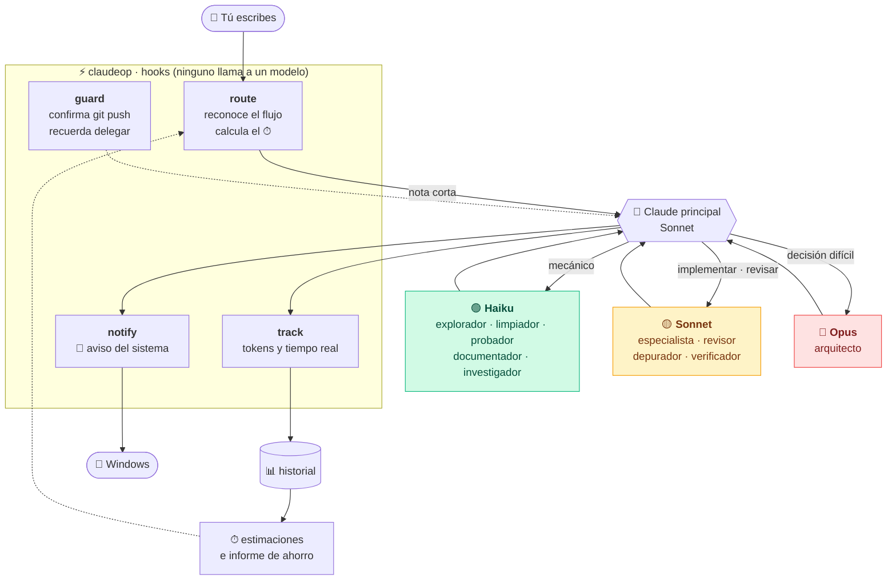

<div align="center">

# ⚡ claudeop

**Claude Code, pero más rápido, más barato y sin que toques nada.**

Reparte el trabajo entre modelos · te dice cuánto va a tardar · te avisa cuando te necesita · mide lo que ahorras

[](https://code.claude.com/docs/en/plugins)
[](plugin/.claude-plugin/plugin.json)
[](https://nodejs.org)
[](LICENSE)

[Instalar](#-instalar) · [Cómo se usa](#-cómo-se-usa) · [Cómo funciona](#-cómo-funciona) · [Qué incluye](#-qué-incluye) · [Plugins que instala](#-plugins-que-instala-solo) · [Ajustes](#-ajustes) · [FAQ](#-faq)

</div>

---

## ✨ ¿Qué es?

Un plugin que instalas **una vez**. Después hablas con Claude Code como siempre, sin comandos ni botones, y él:

| | |
|---|---|
| 🧠 **Reparte el trabajo** | Lo mecánico va a **Haiku** (barato), lo normal a **Sonnet** y solo lo difícil a **Opus**. |
| ⏱ **Te dice cuánto tardará** | Cada tarea empieza con «⏱ ~5–15 min», calculado con lo que tardó antes en tu máquina. |
| 🔔 **Te avisa** | Notificación de Windows cuando termina, pide permiso o te hace una pregunta. |
| 🛡️ **Te protege** | Pide confirmación antes de `git push`, `reset --hard` y otros comandos que no se deshacen. |
| 📊 **Mide el ahorro** | «¿Cuánto he delegado?» → informe real por modelo, agente y tiempos. |
| 🔁 **Retoma el trabajo** | Un trabajo largo sobrevive a cerrar Claude o compactar la conversación. |

---

## 🚀 Instalar

**Necesitas** [Claude Code](https://code.claude.com/docs/en/setup) y [Node.js 18+](https://nodejs.org). Un solo comando lo comprueba todo y lo instala:

**Windows** (PowerShell):
```powershell
irm https://raw.githubusercontent.com/Ivankirito22/ClaudeOP/main/install.ps1 | iex
```

**macOS / Linux**:
```bash
curl -fsSL https://raw.githubusercontent.com/Ivankirito22/ClaudeOP/main/install.sh | bash
```

Si falta Node.js en Windows, lo instala con `winget` (te pedirá cerrar y abrir la terminal una vez).

<details>
<summary><b>Instalación manual</b> (dentro de Claude Code)</summary>

```text
/plugin marketplace add Ivankirito22/ClaudeOP
/plugin install claudeop@claudeop
```
Actualizar: `claude plugin update claudeop` · Desinstalar: `claude plugin uninstall claudeop`
</details>

**Después:** abre (o reinicia) Claude Code. En la primera sesión instala en segundo plano [Claude-Mem y Pro Workflow](#-plugins-que-instala-solo) y te avisa de que reinicies una última vez.

**¿Funciona?** Dile a Claude **«revisa claudeop»**: ejecuta un diagnóstico que prueba Node, los hooks, los agentes y los plugins, y te dice qué falla si algo falla.

---

## 💬 Cómo se usa

No hay nada que aprender. Escribe lo que quieres, con tus palabras (las faltas de ortografía no importan):

```text
tú ▸ limpia el código muerto de este proyecto

Claude ▸ ⏱ ~2–6 min. Criterio de «hecho»: sin imports ni funciones sin referencias…
         Fase 1: lanzo al explorador (Haiku) para localizar candidatos…
```

Otras frases que funcionan tal cual: *«arregla el login que falla»* · *«optimiza mi proyecto y modela un cubo en 3D»* · *«añade un endpoint en FastAPI con tests»* · *«revisa la seguridad»* · *«prepara la release»* · *«opotiza esto»*.

Y para hablar con el propio plugin, también en lenguaje natural:

| Dile a Claude… | Qué hace |
|---|---|
| «¿Cuánto he delegado esta semana?» | Muestra el informe de uso y tiempos. |
| «Revisa claudeop» | Ejecuta el diagnóstico. |
| «Hazlo tú solo, sin delegar» | Esa petición no usa subagentes. |

---

## 🗺️ Cómo funciona



**Quien decide delegar sigue siendo Claude**: el plugin le da la receta y el reparto en cada petición, y los hooks comprueban, miden y avisan. Las preguntas y los cambios pequeños van directos, sin gastar nada extra.

<details>
<summary><b>Los 9 hooks, uno a uno</b></summary>

| Evento | Script | Qué hace |
|---|---|---|
| `SessionStart` | `session-start` | Da a Claude las reglas de reparto y lo que tienes instalado. Retoma `estado.md`. |
| `SessionStart` | `bootstrap` | Instala en segundo plano los plugins recomendados que falten (solo al arrancar). |
| `UserPromptSubmit` | `route` | Reconoce flujos y tecnologías; añade la nota con el ⏱ **solo si hay trabajo**. |
| `PreToolUse` | `guard` | Confirmación de comandos peligrosos; recuerda delegar tras 8 lecturas seguidas. |
| `SubagentStop` | `track` | Anota los tokens de cada subagente por modelo (asíncrono). |
| `Stop` | `track` · `notify` | Anota tokens y duración real; avisa de «terminado» si fue largo (asíncronos). |
| `StopFailure` | `notify` | Avisa si Claude se detiene por un error. |
| `Notification` | `notify` | Avisa si Claude espera un permiso o una respuesta. |
</details>

---

## 🧩 Qué incluye

### 12 agentes, cada uno en el modelo justo

| Modelo | Agente | Para qué |
|---|---|---|
| 🟢 **Haiku** | `explorador` | Leer y buscar en mucho código; devuelve un resumen citado. Solo lectura. |
| | `limpiador` | Cambios mecánicos: código muerto, imports, renombres. Comprueba con grep antes de borrar. |
| | `probador` | Tests, build y lint. Solo informa de los fallos. |
| | `documentador` | Comentarios, docstrings, README y changelog desde el código real. |
| | `investigador` | Busca en la web (fuentes oficiales) y resume con enlaces. |
| 🟡 **Sonnet** | `especialista` | Implementa en **cualquier** lenguaje; recibe la guía de estilo de la tecnología. |
| | `blender` · `juego` | Blender/bpy y Godot/Unity/Unreal; usan su MCP si lo tienes. |
| | `depurador` | Reproduce el fallo y demuestra la causa raíz **antes** de parchear. |
| | `revisor` | Revisa un diff: bugs reales por prioridad, sin nitpicks. |
| | `verificador` | Comprueba el resultado contra el criterio de «hecho», con pruebas. |
| 🔴 **Opus** | `arquitecto` | Solo decisiones difíciles. Devuelve recomendación, alternativas, riesgos y plan. |

Cada agente tiene **tope de turnos** (no se descontrola), **esfuerzo ajustado** a su modelo y un formato de respuesta corto. Los de Haiku **no cargan tu `CLAUDE.md`** (la delegación ya lleva lo necesario), lo que ahorra tokens en cada lanzamiento.

### 19 flujos que se reconocen solos

Si pides varias cosas, se combinan en **un solo trabajo** (una exploración, una verificación al final).

| Completos | Rápidos |
|---|---|
| Feature completa · Bug a fondo · Refactor seguro · Investigar y decidir · Auditoría completa · Pulir lo último · Cazar cuellos de botella · Preparar release | Optimizar proyecto · Limpiar código muerto · Crear `CLAUDE.md` · Explicar el proyecto · Ejecutar tests · Generar tests · Documentar · Revisión de código · Auditoría de seguridad · Recomendar plugins · Investigar en la web |

Todos siguen el mismo esqueleto: **criterio de «hecho» → entender → planificar (solo si es difícil) → hacer → comprobar → verificar**. Lo que no encaje usa el *método general*. ¿Quieres uno propio? Crea un `.md` en `~/.claude/flows/` (o `.claude/flows/`) con `name`, `description` y `triggers: palabra, otra frase`; el cuerpo son las fases.

### Y además

- **⏱ Estimación real.** Mide cuánto tarda cada tipo de tarea (hasta que acaba todo, subagentes incluidos) y estima con el rango habitual (percentiles 25–75). Con menos de 3 muestras usa una estimación inicial y lo dice.
- **📊 Informe de ahorro.** Tokens por modelo y agente, % delegado y tiempos reales. Con `--precios haiku=1,sonnet=3,opus=15` calcula un índice de coste con **tus** precios (no inventa tarifas).
- **🔔 Avisos sin ruido.** «Terminado» solo si tardó más de 20 s; los de permiso solo si tardas unos segundos en contestar; nunca incluyen el contenido de tus mensajes. Funciona en Windows, macOS y Linux (solo probado en Windows).
- **🛡️ Protección real.** Un hook pide confirmación para `git push`, `reset --hard`, `clean -f`, `branch -D` y `rm -rf` sobre rutas amplias. No molesta con `git commit -m "arregla push"`.
- **🔁 Estado en `.claude/claudeop/estado.md`.** En trabajos de 3+ pasos Claude lo mantiene; si cierras o compactas, el siguiente arranque lo retoma.
- **🔎 Usa lo que ya tienes.** Inventaría tus agentes, skills y MCP y solo señala los que **encajan** de verdad con cada petición.

### ⚡ Ligero (medido)

| Qué | Coste |
|---|---|
| Descripciones de los 12 agentes | ~375 tokens por turno *(la versión de 25 agentes: ~1.140)* |
| Reglas de la sesión | ~1.100 tokens, una vez al abrir |
| Nota de una tarea | ~400–500 tokens, **solo** si hay trabajo. «ok», «gracias» o una pregunta: 0 |
| Arranque de sesión | ~90 ms |
| Cada hook | ~90 ms (arranque de Node); los de medición y avisos son asíncronos |

---

## 📦 Plugins que instala solo

`claudeop` reparte el trabajo; estos plugins de terceros le añaden **memoria** y **rutinas**. La lista está en [`plugin/REQUIREMENTS.md`](plugin/REQUIREMENTS.md), como un `requirements.txt`.

| | Plugin | Para qué sirve |
|---|---|---|
| ✅ solo | 🧠 [**Claude-Mem**](https://github.com/thedotmack/claude-mem) | **Memoria entre sesiones.** Claude olvida todo al cerrar; Claude-Mem apunta lo que hace, lo comprime con IA y en la sesión siguiente inyecta solo lo relevante (búsqueda por capas para gastar pocos tokens, visor web local, `<private>` para excluir contenido). |
| ✅ solo | 🔁 [**Pro Workflow**](https://github.com/rohitg00/pro-workflow) | **Corregir una vez y que se quede.** Tus correcciones se guardan como reglas que se cargan solas (`/learn-rule`); trae `/wrap-up` (cerrar sesión con traspaso), `/doctor`, `/smart-commit`, wikis de investigación y vigilancia de commits, secretos y git. |
| ➕ opcional | 🏗️ [Auto Harness](https://github.com/redker56/auto-harness) | Proyectos grandes de varias sesiones: pregunta, redacta una especificación que apruebas, construye por sprints y hace QA, con el estado en `.harness/`. |
| ➕ opcional | 🧬 [Ars Contexta](https://github.com/agenticnotetaking/arscontexta) | Un «segundo cerebro»: genera un vault de notas Markdown enlazadas con `/arscontexta:setup` (≈20 min, muchos tokens) y hace commits automáticos. |

**Por qué solo dos automáticos:** los opcionales hacen lo mismo que algo que ya hay (flujos de `claudeop`, memoria de Claude-Mem); tenerlo todo a la vez gasta contexto y puede dar instrucciones contradictorias. Actívalos con `node plugin/scripts/install-requirements.mjs --optional`.

**Ojo con el coste real:** Claude-Mem deja un servicio en segundo plano y su compresión usa un modelo (gasta tokens); Pro Workflow es grande (decenas de skills y hooks) y solapa en parte con las protecciones de `claudeop`. Si prefieres lo mínimo, `claude plugin uninstall <nombre>` y **no se reinstala**.

**Reglas del instalador:** una vez, en segundo plano, sin bloquearte · no toca lo que ya tienes · si falla, 3 intentos con 12 h entre ellos · cuando todo está resuelto ni consulta la CLI. Desactivar: `CLAUDEOP_NO_INSTALL=1`. Son plugins de terceros que ejecutan hooks en tu máquina: revisa su código si te importa.

---

## 🎛️ Ajustes

Todo es opcional. Variables de entorno (o la propia frase):

| Qué | Cómo |
|---|---|
| Apagar el plugin | `CLAUDEOP=off` |
| Que una petición no delegue | «sin delegar», «no uses agentes», «hazlo tú solo» |
| No instalar los plugins recomendados | `CLAUDEOP_NO_INSTALL=1` |
| Sin confirmaciones de `git push`… | `CLAUDEOP_GUARD=off` |
| Sin avisos del sistema / cambiar el umbral | `CLAUDEOP_NOTIFY=off` · `CLAUDEOP_NOTIFY_MIN_SEC=60` |
| Probar los avisos | `node plugin/scripts/notify.mjs test` |
| Informe de uso | `node plugin/scripts/stats.mjs [--dias N] [--todo] [--json] [--precios …]` |
| Diagnóstico | `node plugin/scripts/doctor.mjs [--notify]` |

**Privacidad:** todo es local. Los registros (`usage.jsonl`, `durations.jsonl`) viven en la carpeta de datos del plugin (`~/.claude/plugins/data/`) y solo guardan modelos, agentes, tokens y duraciones, **nunca el contenido** de tus mensajes. Los avisos tampoco lo llevan.

---

## ❓ FAQ

<details>
<summary><b>No me sale ningún aviso de Windows.</b></summary>

Ejecuta `node plugin/scripts/notify.mjs test`. Si dice «Aviso enviado» y no ves nada, es Windows: desactiva «No molestar» / el Asistente de concentración y activa **Configuración → Sistema → Notificaciones** (salen a nombre de *Windows PowerShell*).
</details>

<details>
<summary><b>Pide confirmación para <code>git push</code> aunque lo pedí yo.</b></summary>

A propósito: un push no se deshace. Confirma y sigue, o usa `CLAUDEOP_GUARD=off`.
</details>

<details>
<summary><b>No veo que delegue.</b></summary>

Pregunta «¿cuánto he delegado?». En proyectos muy pequeños Claude hace bien en no delegar (lanzar un subagente costaría más que hacerlo). Prueba con una tarea de varios pasos. Las notas **empujan, no obligan**: la decisión es de Claude.
</details>

<details>
<summary><b>Claude va pesado: tengo muchos plugins.</b></summary>

Cada plugin y MCP añade contexto fijo a cada turno, y suele pesar más que `claudeop` (en las pruebas, la parte fija ronda los 100k tokens por los plugins de la máquina). Desactiva los que no uses: `claude plugin disable <nombre>`.
</details>

<details>
<summary><b>La estimación de tiempo no acierta.</b></summary>

Al principio es genérica (la nota lo dice) y se afina con tu historial desde 3 tareas parecidas. Mide desde que envías el mensaje, así que un permiso sin contestar cuenta (se descartan las que pasan de 3 h).
</details>

<details>
<summary><b>¿Funciona en macOS y Linux?</b></summary>

Los scripts son Node estándar y hay instalador (`install.sh`), pero **solo se ha probado en Windows 11 con Claude Code 2.1.310**. Si algo falla en otro sistema, abre una [issue](https://github.com/Ivankirito22/ClaudeOP/issues).
</details>

**Límites honestos:** reconocer flujos por palabras no entiende faltas graves (Claude las deduce del catálogo, no es determinista) · la confirmación de comandos peligrosos es obligatoria pero el reparto por modelo no · el «⏱» es una estimación, no una promesa · el índice de coste trata todos los tokens por igual.

---

## 🛠️ Desarrollo

```text
plugin/                  lo que se instala
├── agents/              12 subagentes (.md con model, effort, maxTurns…)
├── hooks/hooks.json     los 9 hooks
├── scripts/             route · session-start · guard · track · notify · bootstrap
│                        stats · doctor · eta · flows · intent · stack · lib · data
└── REQUIREMENTS.md      plugins que se instalan solos
.claude-plugin/          marketplace (apunta a ./plugin)
install.ps1 · install.sh instaladores de un comando
test/plugin.mjs          pruebas de los hooks
```

```bash
npm test                                   # +80 comprobaciones; usa un HOME y un `claude` falsos: no toca tu Claude Code ni gasta nada
claude plugin validate plugin              # valida el manifiesto
```

**Añadir:** un *agente* → `plugin/agents/<nombre>.md` (cada descripción cuesta tokens en *cada* turno: sé breve) · una *tecnología* → su entrada en `scripts/stack.mjs` · un *flujo* → `scripts/flows.mjs` + sus palabras en `scripts/intent.mjs` · un *plugin requerido* → una línea en `REQUIREMENTS.md`.

> Antes existió una app con botones llamada `cla`; se retiró y sigue en el historial de git (último commit con ella: `ed82adc`).

<div align="center">

**MIT** © 2026 [Ivankirito22](https://github.com/Ivankirito22) · Hecho para gastar menos y esperar menos.

</div>
