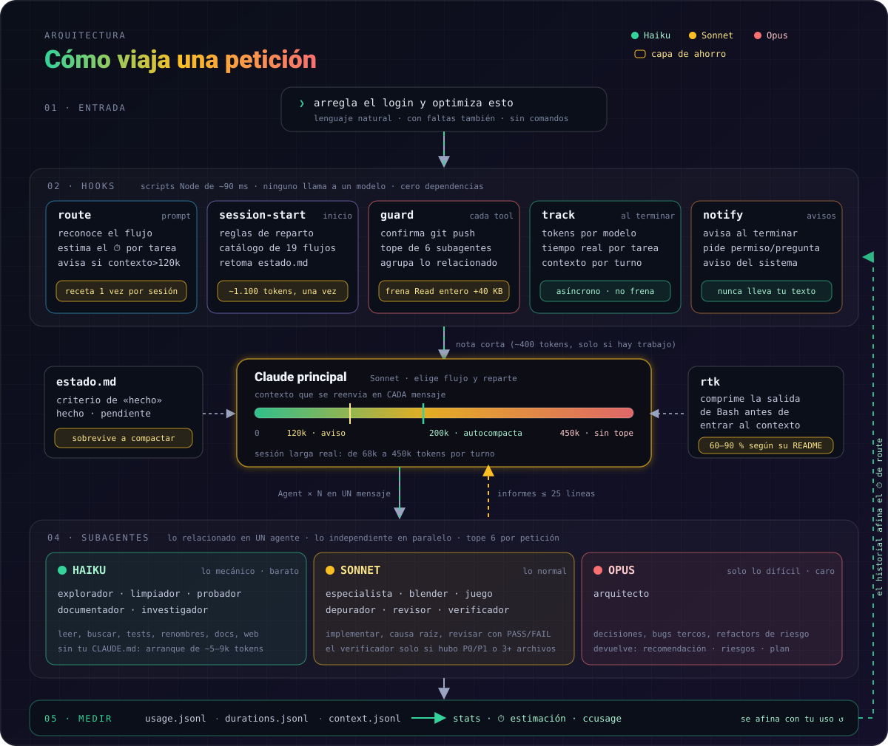

<div align="center">



<br>

[](https://code.claude.com/docs/en/plugins)
[](plugin/.claude-plugin/plugin.json)
[](https://nodejs.org)
[](package.json)
[](test/plugin.mjs)
[](LICENSE)

**Instalas una vez. Hablas como siempre. El plugin reparte el trabajo entre modelos, vigila el contexto y mide lo que ahorra.**

[Instalar](#-instalar) · [Actualizar](#-actualizar) · [Por qué](#-por-qué-existe) · [Cómo funciona](#-cómo-funciona) · [Capas de ahorro](#-capas-de-ahorro) · [Agentes y flujos](#-agentes-y-flujos) · [Instala solo](#-lo-que-instala-solo) · [Ajustes](#-ajustes) · [FAQ](#-faq)

</div>

---

## 👋 ¿Qué es?

Un plugin para **Claude Code**. Lo instalas una vez y no tienes que aprender nada:

| | |
|---|---|
| 🧠 **Reparte el trabajo** | Lo fácil lo hace un modelo barato (Haiku), lo normal uno medio (Sonnet) y solo lo difícil el caro (Opus). Así pagas menos y acaba antes. |
| 🛡️ **Vigila el gasto** | Frena lo que dispara los tokens: conversaciones enormes, archivos gigantes, demasiados ayudantes a la vez. |
| 📊 **Lo mide** | Te dice cuánto tardará cada tarea y cuánto has gastado y ahorrado de verdad. |

## 🚀 Instalar

Necesitas [Claude Code](https://code.claude.com/docs/en/setup) y [Node.js 18+](https://nodejs.org). Un comando lo comprueba todo:

**Windows** (PowerShell)
```powershell
irm https://raw.githubusercontent.com/Ivankirito22/ClaudeOP/main/install.ps1 | iex
```

**macOS / Linux**
```bash
curl -fsSL https://raw.githubusercontent.com/Ivankirito22/ClaudeOP/main/install.sh | bash
```

<details>
<summary><b>Instalación manual</b> (dentro de Claude Code)</summary>

```text
/plugin marketplace add Ivankirito22/ClaudeOP
/plugin install claudeop@claudeop
```
Actualizar: `claude plugin update claudeop` · Desinstalar: `claude plugin uninstall claudeop`
</details>

**Y ya.** Abre Claude Code: en la primera sesión instala en segundo plano [memoria, documentación al día, entendimiento de código y ahorro de tokens](#-lo-que-instala-solo) y te pide reiniciar una vez. ¿Funciona? Dile **«revisa claudeop»** y ejecuta un diagnóstico.

```text
tú     ▸ limpia el código muerto y modela un cubo en 3D           (con faltas también vale)
Claude ▸ ⏱ ~4–12 min · Criterio de «hecho»: sin imports ni funciones sin referencias…
         Fase 1 · explorador (Haiku) localiza candidatos…
         Fase 2 · limpiador (Haiku) aplica lo mecánico · blender (Sonnet) hace el cubo…
```

---

## 🔄 Actualizar

**Se actualiza solo.** Claude Code solo actualiza automáticamente los marketplaces oficiales, así que `claudeop` activa `autoUpdate` para el suyo la primera vez que arranca (solo si no lo habías decidido tú). Desde entonces, al abrir Claude Code comprueba si hay versión nueva, la instala y te pide reiniciar para aplicarla. No tienes que hacer nada.

¿Quieres forzarlo o comprobarlo a mano?

```bash
claude plugin marketplace update claudeop      # trae la última versión del repo
claude plugin update claudeop@claudeop         # la instala (se aplica al reiniciar)
claude plugin list                             # comprueba la versión instalada
```

Dentro de Claude Code también vale `/plugin` → *Marketplaces* → `claudeop` → *Enable auto-update*. Para desactivarlo, pon `"autoUpdate": false` en `extraKnownMarketplaces.claudeop` de tu `settings.json` (claudeop no lo vuelve a tocar).

---

## 🔬 Por qué existe

Medido sobre sesiones reales de Claude Code (Windows 11, transcripts propios, `ccusage`):

| Qué se mide | Resultado | Qué significa |
|---|---|---|
| Contexto base antes de escribir nada | **~72k tokens por mensaje** | casi todo es de *otros* plugins: cientos de skills y MCP |
| Arranque de un subagente de claudeop | **5–9k tokens** | delegar sale barato, pero no gratis |
| Una sesión larga sin tope | de 68k a **450k tokens por turno** | cada mensaje reenvía *toda* la conversación |
| Un día de trabajo intenso | **54M tokens**, el **97 %** caché releída | el gasto lo dispara el contexto acumulado, no los agentes |

> **La lección:** no se gasta por pensar mucho, se gasta por **arrastrar contexto**. Por eso `claudeop` no solo reparte trabajo: también **recorta, frena y mide el contexto**.

<div align="center">

</div>

---

## 🔧 Cómo funciona

<div align="center">

</div>

1. **Tú pides** lo que quieres, con tus palabras. Sin comandos.
2. **Claude decide** cómo hacerlo y a quién le toca cada parte. Te dice cuánto va a tardar.
3. **Los ayudantes trabajan.** Cada uno en el modelo justo: el barato para lo fácil, el caro solo cuando hace falta. Si dos tareas están relacionadas, las hace el mismo ayudante; si son independientes, trabajan a la vez.
4. **Te lo cuenta** en pocas líneas, comprobado, y te avisa cuando termina.

Mientras tanto, **los vigilantes** miran cada paso. Son scripts pequeños (no usan IA, no gastan tokens, ~90 ms) que protegen lo peligroso, limitan los ayudantes, vigilan el tamaño de la conversación y miden lo que pasa.

<details>
<summary><b>Para curiosos: los vigilantes (hooks) uno a uno</b></summary>

| Evento | Script | Qué hace |
|---|---|---|
| `SessionStart` | `session-start` | Da a Claude las reglas de reparto y lo que tienes instalado; retoma `estado.md`; tras compactar vuelve a dar las recetas. |
| `SessionStart` | `bootstrap` | Instala en segundo plano plugins y herramientas que falten (solo al arrancar). |
| `UserPromptSubmit` | `route` | Reconoce flujos y tecnologías; añade la nota con el ⏱ **solo si hay trabajo**; la receta de un flujo se da **una vez por sesión**; avisa al pasar de ~120k de contexto. |
| `PreToolUse` | `guard` | Confirma comandos peligrosos · **tope de 6 subagentes por petición (agrupando lo relacionado)** · **frena una vez la lectura entera de archivos de más de 40 KB** · recuerda delegar tras 8 lecturas seguidas. |
| `SubagentStop` | `track` | Anota los tokens de cada subagente por modelo (asíncrono). |
| `Stop` | `track` · `notify` | Anota tokens, duración y **tamaño del contexto**; avisa de «terminado» si fue largo (asíncronos). |
| `StopFailure` · `Notification` | `notify` | Avisa si Claude se detiene por un error o espera un permiso. |
</details>

---

## 🧱 Capas de ahorro

Cada capa ataca un sitio distinto donde se van los tokens. Todas son automáticas.

| # | Capa | Cómo | Dónde se nota |
|---|---|---|---|
| 1 | **Delegación por modelo** | Lo mecánico a Haiku, lo normal a Sonnet, solo lo difícil a Opus | tokens caros → baratos |
| 2 | **Agrupar y topar subagentes** | Lo relacionado va en UN agente; lo independiente, en paralelo; el 7.º de una petición se bloquea | menos arranques (~6k cada uno) y más rápido |
| 3 | **Freno a lecturas enormes** | Leer entero un archivo de +40 KB se frena una vez: `Grep` + `offset/limit` o al explorador | ese texto se reenviaría en *cada* turno |
| 4 | **Autocompactado a 200k** | Ajuste nativo `autoCompactWindow`: el umbral es el menor entre 200k y la ventana del modelo | corta el crecimiento hasta 450k por turno |
| 5 | **Vigilante de contexto** | Al pasar de 120k avisa y guarda el estado en `estado.md` por si se compacta | sin perder el hilo |
| 6 | **Recetas una sola vez** | La receta de cada flujo se inyecta una vez por sesión; después, solo su nombre | ~400 tokens por tarea repetida |
| 7 | **Revisor con PASS/FAIL** | El revisor ya trae el veredicto del criterio; el verificador solo entra si hubo P0/P1 o 3+ archivos | un subagente Sonnet menos en cada feature |
| 8 | **[rtk](https://github.com/rtk-ai/rtk)** | Comprime la salida de los comandos de Bash antes de que llegue al contexto *(60–90 % según su README)* | salidas de `git`, `npm`, tests… |
| 9 | **Agentes ligeros** | Tope de turnos, esfuerzo ajustado, respuesta corta; los de Haiku no cargan tu `CLAUDE.md` | cada lanzamiento |
| 10 | **Medición** | `stats` (tokens, delegado, contexto mediana/máximo) y `ccusage` (coste por día) | para comparar antes y después |

**Coste propio, medido:** reglas de la sesión ~1.100 tokens (una vez) · descripciones de los 12 agentes ~375 por turno · nota de una tarea ~400–500, solo si hay trabajo (un «gracias» o una pregunta: 0).

---

## 🧩 Agentes y flujos

### 12 agentes, cada uno en el modelo justo

| Modelo | Agente | Para qué |
|---|---|---|
| 🟢 **Haiku** | `explorador` | Leer y buscar en mucho código; devuelve un resumen citado. Solo lectura. |
| | `limpiador` | Cambios mecánicos: código muerto, imports, renombres. Comprueba con grep antes de borrar. |
| | `probador` | Tests, build y lint. Solo informa de los fallos. |
| | `documentador` | Comentarios, docstrings, README y changelog desde el código real. |
| | `investigador` | Busca en la web (fuentes oficiales) y resume con enlaces. |
| 🟡 **Sonnet** | `especialista` | Implementa en **cualquier** lenguaje; recibe la guía de estilo de la tecnología. |
| | `blender` · `juego` | Blender/bpy y Godot/Unity/Unreal; usan su MCP si lo tienes. |
| | `depurador` | Reproduce el fallo y demuestra la causa raíz **antes** de parchear. |
| | `revisor` | Revisa un diff: bugs reales por prioridad, sin nitpicks; abre con PASS/FAIL del criterio. |
| | `verificador` | Comprueba el resultado contra el criterio de «hecho», con pruebas. |
| 🔴 **Opus** | `arquitecto` | Solo decisiones difíciles: recomendación, alternativas descartadas, riesgos y plan. |

### 19 flujos que se reconocen solos

| Completos | Rápidos |
|---|---|
| Feature completa · Bug a fondo · Refactor seguro · Investigar y decidir · Auditoría completa · Pulir lo último · Cazar cuellos de botella · Preparar release | Optimizar proyecto · Limpiar código muerto · Crear `CLAUDE.md` · Explicar el proyecto · Ejecutar tests · Generar tests · Documentar · Revisión de código · Auditoría de seguridad · Recomendar plugins · Investigar en la web |

Todos siguen el mismo esqueleto: **criterio de «hecho» → entender → planificar (solo si es difícil) → hacer → comprobar → verificar**. Si pides varias cosas, se combinan en **un solo trabajo**. ¿Quieres uno propio? Crea un `.md` en `~/.claude/flows/` con `name`, `description` y `triggers: palabra, otra frase`; el cuerpo son las fases.

### Y además

- **⏱ Estimación real:** mide cuánto tarda cada tipo de tarea y estima con tu rango habitual (percentiles 25–75).
- **🛡️ Protección real:** un hook pide confirmación para `git push`, `reset --hard`, `clean -f`, `branch -D` y `rm -rf` amplios.
- **🔁 Retoma el trabajo:** en tareas de 3+ pasos mantiene `.claude/claudeop/estado.md`; si cierras o compactas, el siguiente arranque lo retoma.
- **🔔 Avisos sin ruido:** «terminado» solo si tardó más de 20 s; nunca incluyen el contenido de tus mensajes.
- **🔎 Usa lo que ya tienes:** inventaría tus agentes, skills y MCP y solo señala los que encajan con cada petición.

---

## 📦 Lo que instala solo

La primera vez que abres Claude Code, `claudeop` instala **en segundo plano** lo siguiente y te pide reiniciar una vez. La lista vive en [`plugin/REQUIREMENTS.md`](plugin/REQUIREMENTS.md).

**Reglas:** una sola vez · sin bloquearte · no toca lo que ya tienes · **lo que quites no vuelve** · si algo falla, 3 intentos con 12 h entre ellos · cada ajuste de `settings.json` solo se pone si no existía y deja copia `.bak`.

### Plugins de Claude Code

| | Plugin | Qué hace por ti | Coste de contexto |
|---|---|---|---|
| 🧠 | [**Claude-Mem**](https://github.com/thedotmack/claude-mem) | **Memoria entre sesiones.** Apunta lo que haces y en la siguiente sesión te devuelve solo lo relevante, en vez de empezar de cero. | ~2k tokens por mensaje |
| 📚 | [**Context7**](https://github.com/upstash/context7) | **Documentación actualizada de las librerías**, de la versión exacta que usas. Claude consulta la doc real en vez de inventarse una API (menos errores y menos reintentos). Funciona sin clave. | 2 herramientas MCP |
| 🔎 | **typescript-lsp** y **pyright-lsp** *(oficiales de Anthropic)* | **Entienden el código de verdad.** Claude va a la definición de una función, ve dónde se usa y ve los errores reales del lenguaje, en vez de leer archivos enteros. Instala solo el servidor de TypeScript/JavaScript y, si tienes Python, el de Pyright. | prácticamente nulo |

### Herramientas y ajustes

| | Pieza | Qué hace por ti |
|---|---|---|
| ✂️ | [**rtk**](https://github.com/rtk-ai/rtk) | **Comprime la salida de los comandos** de Bash antes de que llegue al contexto *(60–90 % según su README)*. Solo añade un hook; se quita con `rtk init -g --uninstall`. |
| 📟 | [**ccstatusline**](https://github.com/sirmalloc/ccstatusline) | **Barra de estado** con el contexto en tokens, para ver cuándo la conversación se hincha. Solo si no tienes ya una. |
| 📉 | **Autocompactado a 200k** | Tope nativo al contexto (`autoCompactWindow`): cuando la conversación llega a 200k tokens se compacta sola. Se cambia con `/autocompact`. |
| 🔄 | **Actualización automática** | Pone `autoUpdate` al marketplace de claudeop: al abrir Claude Code se actualiza el plugin solo ([más info](#-actualizar)). |
| 💸 | [**ccusage**](https://github.com/ryoppippi/ccusage) | No se instala: cuando preguntas «¿cuánto gasto?», Claude lo ejecuta con `npx` y te da tokens y coste por día. |

### Cómo se ayudan entre sí

- **Escribir bien a la primera:** Context7 aporta la API correcta y el LSP el código real → menos lecturas y menos reintentos.
- **Gastar menos:** rtk comprime lo que sale de los comandos, el autocompactado corta la conversación en 200k y el freno de `claudeop` evita leer archivos enormes enteros.
- **Recordar y medir:** Claude-Mem guarda lo hecho; ccstatusline y ccusage enseñan lo que gastas; `stats` lo cruza con lo delegado.
- **Mismo criterio de seguridad:** `claudeop` confirma `git push` y comandos peligrosos; nada de lo anterior se salta esa protección.

### Opcionales (no se instalan solos)

Se activan con `node plugin/scripts/install-requirements.mjs --optional`. Van aparte porque solapan con algo que ya hay o **gastan tokens por su cuenta**:

| Plugin | Qué hace | Por qué no es automático |
|---|---|---|
| [Pro Workflow](https://github.com/rohitg00/pro-workflow) | Tus correcciones se guardan como reglas; `/wrap-up`, `/doctor`, vigilancia de git. | ~3,6k tokens en **cada** mensaje y solapa con las protecciones y medidas de `claudeop`. |
| [security-guidance](https://github.com/anthropics/claude-plugins-official/tree/main/plugins/security-guidance) | Avisa de patrones inseguros al editar y revisa el diff con IA. | Su revisión con Opus **cuesta tokens** (~0,2 $ por revisión según su doc) y al arrancar monta un entorno Python. Si lo quieres: `SECURITY_REVIEW_MODEL=claude-sonnet-5-5` y `ENABLE_STOP_REVIEW=0`. |
| [Playwright](https://github.com/microsoft/playwright-mcp) | Claude abre un navegador y prueba tu web. | Sus herramientas MCP están siempre cargadas: solo en proyectos web. |
| code-review | Revisa un pull request con varios agentes. | `claudeop:revisor` ya revisa el diff local. |
| [Auto Harness](https://github.com/redker56/auto-harness) · [Ars Contexta](https://github.com/agenticnotetaking/arscontexta) | Trabajo largo por sprints · un «segundo cerebro» de notas. | Solapan con los flujos de `claudeop` y con Claude-Mem. |

> ⚠️ Son herramientas de terceros que ejecutan hooks o servidores en tu máquina: revisa su código si te importa. Context7 envía a `mcp.context7.com` el nombre de la librería y tu pregunta. Desactivar todo: `CLAUDEOP_NO_INSTALL=1`; solo herramientas y ajustes: `CLAUDEOP_NO_TOOLS=1`.

---

## 🔩 Ajustes

Todo es opcional. Variables de entorno (o la propia frase):

| Qué | Cómo |
|---|---|
| Apagar el plugin | `CLAUDEOP=off` |
| Que una petición no delegue | «sin delegar», «no uses agentes», «hazlo tú solo» |
| No instalar plugins / herramientas | `CLAUDEOP_NO_INSTALL=1` · `CLAUDEOP_NO_TOOLS=1` |
| Sin confirmaciones de `git push`… | `CLAUDEOP_GUARD=off` |
| Tope de subagentes por petición (6) | `CLAUDEOP_MAX_AGENTS=8` |
| Freno a lecturas grandes (40 KB; 0 = sin freno) | `CLAUDEOP_BIG_READ_KB=100` |
| Avisos del sistema / umbral | `CLAUDEOP_NOTIFY=off` · `CLAUDEOP_NOTIFY_MIN_SEC=60` |

Y hablando con Claude: **«¿cuánto he delegado esta semana?»** → informe de uso, tiempos y contexto (`node plugin/scripts/stats.mjs [--dias N] [--todo] [--json] [--precios haiku=1,sonnet=3,opus=15]`) · **«revisa claudeop»** → diagnóstico (`doctor.mjs`) · **«¿cuánto gasto por día?»** → `ccusage`.

**Privacidad:** todo es local. Los registros (`usage.jsonl`, `durations.jsonl`, `context.jsonl`) viven en `~/.claude/plugins/data/` y solo guardan modelos, agentes, tokens y duraciones, **nunca el contenido** de tus mensajes.

---

## ❓ FAQ

<details>
<summary><b>Claude va pesado o gasto mucho: tengo muchos plugins.</b></summary>

Cada plugin, skill y MCP añade contexto fijo a **cada** mensaje, y suele pesar más que `claudeop`. Mira cuánto cuesta cada uno con `claude plugin details <nombre>` y desactiva los que no uses: `claude plugin disable <nombre>`. Es el mayor ahorro posible.
</details>

<details>
<summary><b>Me frena al leer un archivo grande.</b></summary>

A propósito, y solo una vez por archivo: leerlo entero lo metería en el contexto de todos los turnos siguientes. Si lo necesitas entero, vuelve a pedirlo; o sube el umbral con `CLAUDEOP_BIG_READ_KB`.
</details>

<details>
<summary><b>Bloquea un subagente («ya hay 6 en esta petición»).</b></summary>

Cada subagente cuesta ~6k tokens solo por arrancar. Claude reutiliza lo ya devuelto o agrupa lo pendiente (lo relacionado, en un solo agente). Sube el tope con `CLAUDEOP_MAX_AGENTS`.
</details>

<details>
<summary><b>Pide confirmación para <code>git push</code> aunque lo pedí yo.</b></summary>

A propósito: un push no se deshace. Confirma y sigue, o usa `CLAUDEOP_GUARD=off`.
</details>

<details>
<summary><b>No veo que delegue.</b></summary>

Pregunta «¿cuánto he delegado?». En proyectos pequeños Claude hace bien en no delegar (un subagente costaría más que hacerlo). Las notas **empujan, no obligan**.
</details>

<details>
<summary><b>¿Qué modelo principal me conviene?</b></summary>

**Sonnet** (`/model sonnet`): en una instalación limpia el principal por defecto fue Opus (el 85 % de los tokens). Con Sonnet de principal, Haiku para lo mecánico y Opus solo para el `arquitecto`, el reparto sale mucho más barato.
</details>

<details>
<summary><b>No me sale ningún aviso de Windows.</b></summary>

Ejecuta `node plugin/scripts/notify.mjs test`. Si dice «Aviso enviado» y no ves nada, desactiva «No molestar» y activa **Configuración → Sistema → Notificaciones** (salen a nombre de *Windows PowerShell*).
</details>

<details>
<summary><b>¿Funciona en macOS y Linux?</b></summary>

Los scripts son Node estándar y hay `install.sh`, pero **solo se ha probado en Windows 11 con Claude Code 2.1.310**. Si falla en otro sistema, abre una [issue](https://github.com/Ivankirito22/ClaudeOP/issues).
</details>

**Límites honestos:** reconocer flujos por palabras no entiende faltas graves (Claude las deduce del catálogo; no es determinista) · confirmar comandos peligrosos y los topes son obligatorios, pero el reparto por modelo es una recomendación · el «⏱» es una estimación · rtk puede ocultar detalle al depurar (`rtk proxy <comando>` da la salida completa).

---

## 🧰 Desarrollo

```text
plugin/                       lo que se instala
├── agents/                   12 subagentes (.md con model, effort, maxTurns…)
├── hooks/hooks.json          9 hooks en 7 eventos
├── scripts/
│   ├── route · session-start · guard · track · notify     los hooks
│   ├── bootstrap · tools · requirements · install-requirements   instaladores
│   ├── ctx · eta · flows · intent · stack · lib · data     piezas comunes
│   └── stats · doctor                                      informes
└── REQUIREMENTS.md           lo que se instala solo
assets/                       banner, architecture y savings (.svg de este README)
.claude-plugin/               marketplace (apunta a ./plugin)
install.ps1 · install.sh      instaladores de un comando
test/plugin.mjs               120+ comprobaciones
```

```bash
npm test                          # usa un HOME y un `claude` falsos: no toca tu Claude Code ni gasta nada
claude plugin validate plugin     # valida el manifiesto
```

**Añadir:** un *agente* → `plugin/agents/<nombre>.md` (cada descripción cuesta tokens en *cada* turno: sé breve) · una *tecnología* → `scripts/stack.mjs` · un *flujo* → `scripts/flows.mjs` + sus palabras en `scripts/intent.mjs` · un *plugin requerido* → una línea en `REQUIREMENTS.md` · una *herramienta* → `scripts/tools.mjs`.

<div align="center">

**MIT** © 2026 [Ivankirito22](https://github.com/Ivankirito22) · Hecho para gastar menos y esperar menos.

</div>
