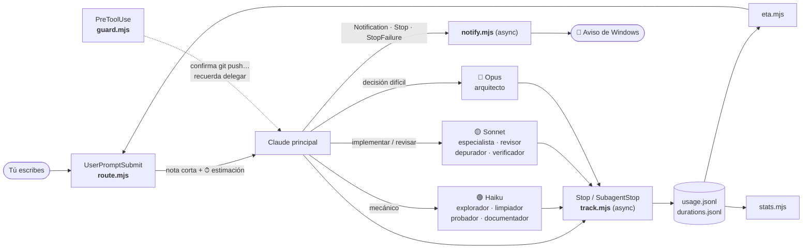

<div align="center">

# ⚡ claudeop

### Instálalo una vez. Habla con Claude Code como siempre. Él reparte el trabajo, te dice cuánto va a tardar y te enseña cuánto ahorras.

[](https://code.claude.com/docs/en/plugins)
[](plugin/.claude-plugin/plugin.json)
[](https://nodejs.org)
[](LICENSE)

**Cero comandos · Cero botones · Cero etiquetas**

[Instalar](#-instalar) · [Cómo se usa](#-cómo-se-usa) · [Qué hace](#-qué-hace) · [Cómo funciona](#-cómo-funciona) · [Ajustes](#-ajustes) · [FAQ](#-preguntas-frecuentes)

</div>

---

## ✨ En una frase

`claudeop` convierte a Claude Code en un **equipo coordinado**: reconoce lo que pides (aunque escribas con faltas), elige el método de trabajo, **manda lo barato a Haiku, lo normal a Sonnet y solo lo difícil a Opus**, te dice el **tiempo estimado** antes de empezar, te manda un **aviso de Windows** cuando te necesita o termina, y **mide** lo que de verdad se ahorra. Todo sin que aprendas un solo comando.

| Sin claudeop | Con claudeop |
|---|---|
| Un único modelo hace todo, también lo mecánico (leer 40 archivos, correr tests, borrar imports). | Lo mecánico va a **Haiku** (más barato); el modelo principal solo piensa y coordina. |
| «¿Cuánto va a tardar?» No lo sabes hasta que acaba. | Cada tarea empieza con **«⏱ ~5–15 min»**, calculado con lo que tardó antes en tu máquina. |
| «Ojo, que no haga `git push`»: confías en que se acuerde. | Un hook **pide confirmación** antes de `git push`, `reset --hard` y comandos que no se deshacen. |
| Dejas la terminal y no sabes si acabó o si espera tu permiso. | Un **aviso del sistema** («✅ Claude ha terminado», «🔐 Claude necesita tu permiso»). |
| ¿Ahorra algo? Ni idea. | «¿Cuánto he delegado?» → un informe con modelo, agente y tiempos reales. |
| Un trabajo largo se pierde al compactar o reiniciar. | Deja su estado en un archivo y **retoma** donde lo dejó. |
| Instalar memoria, flujos… a mano, uno a uno. | Instala **solo** los plugins recomendados la primera vez. |

---

## 🚀 Instalar

Necesitas **Claude Code** y **Node.js 18 o superior** (los hooks son scripts de Node). Probado con Claude Code 2.1.310 en Windows 11.

**1.** Dentro de Claude Code, añade el marketplace e instala el plugin:

```text
/plugin marketplace add Ivankirito22/ClaudeOP
/plugin install claudeop@claudeop
```

**2.** Reinicia Claude Code.

**3.** Listo. En esa primera sesión `claudeop` instala en segundo plano los [plugins recomendados](#-plugins-que-se-instalan-solos) y Claude te avisa de que reinicies una vez más cuando terminen. A partir de ahí no vuelve a tocar nada.

<details>
<summary><b>Más formas de instalarlo</b></summary>

- **Desde una carpeta local** (sin GitHub): `/plugin marketplace add C:\ruta\a\ClaudeOP` y luego `/plugin install claudeop@claudeop`.
- **Probar sin instalar**: `claude --plugin-dir C:\ruta\a\ClaudeOP\plugin`.
- **Actualizar**: `claude plugin update claudeop` y reinicia.
- **Desinstalar**: `claude plugin uninstall claudeop`.

</details>

---

## 💬 Cómo se usa

**No hay nada que aprender.** Escribe lo que quieres, como lo dirías a una persona:

```text
tú ▸ limpia el código muerto de este proyecto

Claude ▸ ⏱ ~2–6 min. Criterio de «hecho»: sin imports, variables, funciones ni archivos
         huérfanos sin referencias, y el proyecto sigue funcionando.
         Fase 1: lanzo al explorador (Haiku) para localizar candidatos…
```

*(Captura real de una sesión, resumida.)*

Frases que funcionan tal cual: «arregla el login que falla», «optimiza mi proyecto y modela un cubo en 3D», «añade un endpoint en FastAPI con tests», «revisa la seguridad de este repo», «prepara la release», «opotiza esto» (sí, con la falta).

Y para preguntarle cosas al propio plugin, también en lenguaje natural:

| Dile a Claude… | Qué pasa |
|---|---|
| «¿Cuánto he delegado esta semana?» | Ejecuta el informe de `stats` y te lo resume. |
| «Instala los requisitos de claudeop» | Ejecuta el instalador a mano. |
| «Hazlo tú solo, sin delegar» | Esa petición no usa subagentes. |

---

## 🧩 Qué hace

### 1. Reparte el trabajo por modelo

12 subagentes, cada uno en el modelo más barato que lo hace bien:

| Modelo | Agente | Para qué |
|---|---|---|
| 🟢 **Haiku** (barato) | `explorador` | Leer y buscar en mucho código, devolver un resumen con rutas y líneas. Solo lectura. |
| | `limpiador` | Cambios mecánicos: código muerto, imports, renombres, formato. |
| | `probador` | Tests, build y lint. Solo informa de los fallos. |
| | `documentador` | Comentarios, docstrings, README. |
| | `investigador` | Buscar en la web y resumir con fuentes. |
| 🟡 **Sonnet** | `especialista` | Implementar en **cualquier** lenguaje (Python, JS/TS, Go, Rust, C++, Java, SQL, móvil, DevOps…). |
| | `blender` · `juego` | Blender/bpy y Godot/Unity/Unreal. Heredan todas las herramientas para usar su MCP si lo tienes. |
| | `depurador` | Reproduce un fallo y halla la causa raíz **antes** de parchear. |
| | `revisor` | Revisa diffs y cambios arriesgados. |
| | `verificador` | Comprueba al final que se cumple lo pedido. |
| 🔴 **Opus** (caro) | `arquitecto` | Solo decisiones difíciles: arquitectura, bugs rebeldes, rendimiento complejo. |

> Un subagente no hereda la conversación, así que Claude le da instrucciones completas y comprueba lo que devuelve. Los pasos independientes se lanzan **en paralelo**.

### 2. Aplica un método, no improvisa

21 flujos que se reconocen solos por lo que escribes. Si pides varios a la vez, se **combinan en un solo trabajo** (una exploración, una verificación al final).

| Flujos completos (varias fases) | Flujos rápidos |
|---|---|
| Feature completa · Bug a fondo · Refactor seguro · Investigar y decidir · Auditoría completa · Pulir lo último · Cazar cuellos de botella · Preparar release | Optimizar proyecto · Limpiar código muerto · Crear/actualizar `CLAUDE.md` · Explicar el proyecto · Ejecutar tests/build · Generar tests · Documentar código · Cazar un bug · Revisión de código · Auditoría de seguridad · Mensaje de commit · Recomendar plugins/MCP · Investigar en la web |

Todos siguen el mismo esqueleto: **criterio de «hecho» → entender → planificar (solo si es difícil) → hacer → comprobar → verificar**. Si lo que pides no encaja con ninguno, se aplica igualmente el *método general*.

¿Quieres uno propio? Crea un `.md` en `~/.claude/flows/` o `.claude/flows/`:

```markdown
---
name: Lanzamiento de juego
description: Prepara el lanzamiento de un juego
triggers: lanzar el juego, publicar el juego
---
1. Comprueba el build.
2. Sube a la tienda.
```

### 3. ⏱ Te dice cuánto va a tardar

Antes de empezar cada tarea, Claude escribe **«⏱ ~X–Y min»**. No es una frase inventada: `claudeop` **mide cuánto tarda cada tipo de tarea en tu máquina** (desde que envías el mensaje hasta que Claude termina, incluidos los subagentes en segundo plano) y calcula el rango habitual (percentiles 25–75) con tu historial.

- Con menos de 3 tareas parecidas usa una **estimación inicial** razonable, y lo dice.
- Cuanto más lo usas, más se afina. Si combinas varios flujos, estima como un solo trabajo.
- Claude puede corregirla si la tarea es claramente más grande o más pequeña de lo normal.

### 4. 📊 Mide cuánto delega y cuánto tarda

Cada vez que Claude termina, un hook **asíncrono** (no te frena) anota qué modelo gastó cuántos tokens, en el hilo principal y en cada subagente. Pregúntale «¿cuánto he delegado?» o ejecuta `node plugin/scripts/stats.mjs`:

```text
claudeop · uso de los últimos 7 días (1 sesión)

Tokens por modelo (entrada + salida + caché)
  sonnet  █████████░  89%    166k   principal 166k · subagentes 0
  haiku   █░░░░░░░░░  11%     21k   principal 0 · subagentes 21k

Delegado en subagentes: 11% de los tokens · en Haiku: 11%
Coste relativo con tus precios: 92% de lo que habría costado todo en sonnet

Subagentes
  explorador       1 uso   haiku         21k tokens (477 de salida)

Tiempo real por tipo de tarea (con esto se calcula el «⏱ ~X–Y min» de cada petición)
  Limpiar código muerto                1×  mediana 40 s     rango habitual aún pocas muestras
```

*(Ejemplo real, de las sesiones de prueba.)* Claude conoce la ruta del script y lo ejecuta por ti; si lo lanzas tú, está en `scripts/` dentro de la carpeta del plugin instalado. Opciones: `--dias 30`, `--todo`, `--json` y `--precios haiku=1,sonnet=3,opus=15` para un índice de coste con **tus** precios (el plugin no inventa tarifas; el índice cuenta todos los tipos de token por igual, así que es una estimación).

### 5. 🛡️ Protege lo que no se deshace

Un hook `PreToolUse` **pide tu confirmación** (no bloquea a ciegas) antes de:

`git push` · `git reset --hard` · `git clean -f` · `git branch -D` · `rm -rf` sobre `/`, `~`, `*` o `.`

Entiende comandos encadenados (`cd x && git push`) y opciones (`git -C ruta push`), y **no molesta** con `git commit -m "arregla push"` ni `git log --grep push`. Comprobado en una sesión real de Claude Code: bloquea y explica el motivo.

Además, si el modelo principal lleva **8 lecturas o búsquedas seguidas** en una misma petición, le recuerda que delegue en `explorador` (una vez por petición; las lecturas de los subagentes no cuentan).

### 6. 🔔 Te avisa cuando te necesita (o cuando acaba)

Puedes dejar Claude trabajando y ponerte con otra cosa: `claudeop` lanza una **notificación del sistema** (toast de Windows; también funciona en macOS con `osascript` y en Linux con `notify-send`) en estos casos:

| Aviso | Cuándo |
|---|---|
| 🔐 **Claude necesita tu permiso** | Espera que apruebes o rechaces algo: subir cambios (`git push`), ejecutar un comando, usar una herramienta. Dice cuál y de qué proyecto. |
| ✅ **Claude ha terminado** | Acaba una petición **larga** (más de 20 s; así no te avisa de cada respuesta corta). Incluye el proyecto y cuánto tardó. |
| ❓ **Claude necesita una respuesta tuya** | Un servidor MCP te pide datos o una elección. |
| ⏳ **Claude te está esperando** | Terminó hace un rato (≈1 min) y sigues sin escribir. No se repite si ya te avisó de que terminó. |
| 🤖 Un agente necesita tu respuesta / ha terminado | Sesiones en segundo plano. |
| ⚠️ **Claude se ha detenido por un error** | Un fallo de la API u otro error. |

Está pensado para **no molestar**: si estás delante y contestas, no salta nada (Claude Code espera unos segundos antes de avisar de un permiso), y mientras queden subagentes trabajando no dice que terminó. Los avisos **nunca incluyen el contenido** de tus mensajes ni de las respuestas, solo el motivo, el nombre del proyecto y la duración.

```bash
node plugin/scripts/notify.mjs test        # manda un aviso de prueba
```

Si no te aparece: revisa que Windows no esté en «No molestar» / Asistente de concentración y que **Configuración → Sistema → Notificaciones** esté activado (los avisos salen con el nombre de *Windows PowerShell*). Ajustes: `CLAUDEOP_NOTIFY=off` los apaga y `CLAUDEOP_NOTIFY_MIN_SEC=60` cambia el umbral de «terminado».

### 7. 🔁 Retoma los trabajos largos

En tareas de 3+ pasos, Claude mantiene `.claude/claudeop/estado.md` (máx. 15 líneas: criterio de «hecho» · hecho · pendiente). Si cierras Claude, se compacta la conversación o vuelves mañana, el siguiente arranque **lo lee y retoma** (hasta 7 días). Al terminar lo borra.

### 8. 🔎 Usa lo que ya tienes instalado

Al abrir la sesión inventaría tus agentes, skills, comandos, plugins y servidores MCP (por ejemplo, Blender). En cada petición solo le señala a Claude los que **encajan de verdad** (con puntuación por relevancia, no por una palabra suelta). No vuelca cientos de herramientas en el contexto.

### 9. ⚙️ Es ligero

Cada pieza se paga en tokens en cada turno, así que está medido:

| Qué | Coste |
|---|---|
| Descripciones de los 12 agentes | ~560 tokens por turno *(eran ~1.140 con 25 agentes)* |
| Reglas de la sesión | ~1.4k tokens, una vez al abrir |
| Nota de una tarea | ~550–650 tokens, **solo** si hay trabajo. «ok», «gracias» o una pregunta no gastan nada. |
| Guía de estilo de una tecnología | Solo la de la tecnología que toca (antes, 14 agentes siempre cargados) |
| Arranque de sesión | ~90 ms *(eran 1,3 s: reutiliza el catálogo si no cambió tu configuración)* |
| Hooks por mensaje / por herramienta | ~90 ms (arranque de Node en Windows) |

Ningún hook llama a un modelo.

---

## 📦 Plugins que se instalan solos

La lista vive en [`plugin/REQUIREMENTS.md`](plugin/REQUIREMENTS.md), como un `requirements.txt`. La primera vez que abres Claude Code con `claudeop`, un hook añade los marketplaces e instala en segundo plano lo que falte.

Cuatro plugins de terceros, dos que se instalan solos y dos opcionales. `claudeop` reparte el trabajo; estos le añaden **memoria** y **rutinas de trabajo**. Lo que sigue es lo que hace cada uno según su propia documentación, para qué te sirve y lo que cuesta.

| Plugin | En una frase | Te sirve si… | Se instala |
|---|---|---|---|
| [**Claude-Mem**](https://github.com/thedotmack/claude-mem) | Claude recuerda lo que hizo en sesiones anteriores. | Retomas proyectos a menudo y no quieres explicar el contexto cada vez. | ✅ solo |
| [**Pro Workflow**](https://github.com/rohitg00/pro-workflow) | Tus correcciones se vuelven reglas, y rutinas para cerrar sesión y hacer commits. | Corriges a Claude lo mismo una y otra vez. | ✅ solo |
| [Auto Harness](https://github.com/redker56/auto-harness) | Equipo de planificación, desarrollo y QA para proyectos de varias sesiones. | Construyes algo grande a partir de un brief. | ➕ opcional |
| [Ars Contexta](https://github.com/agenticnotetaking/arscontexta) | Un «segundo cerebro» de notas enlazadas que genera para ti. | Quieres tu propia base de conocimiento en Markdown. | ➕ opcional |

### ✅ Los que se instalan solos

#### 🧠 Claude-Mem — memoria entre sesiones

Claude Code olvida todo al cerrar la sesión. Claude-Mem **apunta lo que hace** (herramientas usadas, decisiones, resúmenes), lo comprime con IA y lo guarda en una base de datos local (SQLite con búsqueda de texto, más una base vectorial Chroma para buscar por significado). En la siguiente sesión **inyecta solo el contexto relevante** de las anteriores. Para no gastar tokens, la búsqueda va por capas: primero un índice compacto, luego una línea de tiempo y solo al final el detalle de lo que eliges. Incluye un visor web local para ver la memoria y las sesiones, y las etiquetas `<private>…</private>` excluyen lo que no quieras guardar.

> **Ojo con el coste:** deja un servicio en segundo plano (un *worker* de Bun con API HTTP y visor locales), la compresión usa un modelo de IA (gasta tokens) y necesita Node 20+ (Bun y `uv` se instalan solos). Los datos son locales por defecto (ajustes en `~/.claude-mem/settings.json`). La sincronización en la nube y su «observador» alojado son **opcionales** y piden iniciar sesión: lee su documentación antes de activarlos.

#### 🔁 Pro Workflow — corregir una vez y que se quede

Cuando corriges a Claude, esa corrección puede guardarse como **regla** (`/learn-rule`) que se carga sola al empezar cada sesión. Además trae rutinas listas:

| Comando | Para qué |
|---|---|
| `/wrap-up` | Cierra la sesión: revisa los cambios, guarda lo aprendido y escribe un traspaso para la siguiente. |
| `/doctor` | Comprueba que la base de datos, los hooks y las skills cargan bien. |
| `/smart-commit` | Pasa comprobaciones y escribe el mensaje de commit. |
| `/wiki` | Crea y consulta «wikis» de investigación que se inyectan cuando tu mensaje trata ese tema. |
| `/develop` | Investigar → planificar → implementar, con puertas de validación entre fases. |

También vigila: mensajes de commit, **secretos antes de escribir un archivo** y operaciones git arriesgadas; guarda el estado a través de la compactación y sigue el coste de la sesión. Todo se guarda en local (`~/.pro-workflow/`).

> **Ojo:** es grande (según su README, 41 skills, 8 agentes, 23 comandos y 33 scripts de hooks), así que añade contexto y hooks. **Solapa en parte con `claudeop`** (guardas de git, estado al compactar, coste de sesión): no se pisan, pero verás dos capas de protección. Si prefieres lo mínimo, `claude plugin uninstall pro-workflow` y no se reinstala.

### ➕ Los opcionales

#### 🏗️ Auto Harness — proyectos grandes de varias sesiones

Le das un *brief* y trabaja como un equipo: **te hace preguntas, redacta una especificación que debes aprobar, construye sprint a sprint** (agentes *Generator* escriben el código; agentes *Evaluator* revisan contratos, hacen QA con el navegador mediante Playwright MCP y repiten las pruebas tras cada arreglo) y termina con un informe final. Todo el estado vive en archivos Markdown en `.harness/`, así que puedes parar y retomarlo repitiendo el comando: `/auto-harness:harness <brief>` (o `/auto-harness:harness-parallel` para construir tareas independientes a la vez en *git worktrees*).
**Por qué es opcional:** solapa con los flujos de `claudeop` (Feature completa, Bug a fondo) y es excesivo para tareas normales.

#### 🧬 Ars Contexta — tu «segundo cerebro»

Ejecutas `/arscontexta:setup`, contestas 2–4 preguntas sobre tu campo (unos 20 minutos y **muchos tokens**, una sola vez) y genera un *vault* de notas Markdown enlazadas (`self/` la identidad del agente, `notes/` el grafo de conocimiento, `ops/` las colas y el estado), con comandos como `/reduce`, `/reflect` y `/reweave` para extraer ideas y conectar notas. Sus hooks validan la estructura al guardar y **hacen commits automáticos en git**. Necesita `tree` y `ripgrep` (y, opcional, [qmd](https://github.com/tobi/qmd) para búsqueda semántica).
**Por qué es opcional:** es una segunda memoria que compite con Claude-Mem; úsalo si quieres un vault de conocimiento que sea tuyo.

### ¿Por qué solo dos automáticos?

Tenerlo todo a la vez gasta contexto en cada petición y puede dar instrucciones contradictorias, así que se instalan solos los que aportan algo que `claudeop` no hace (memoria y correcciones persistentes). Activa los opcionales cuando quieras con `node plugin/scripts/install-requirements.mjs --optional`.

**Reglas del instalador:**

- Una vez, al abrir una sesión nueva, en segundo plano y sin bloquearte.
- Lo que ya tienes no se toca. Si instalas uno y luego lo **quitas, no se reinstala**.
- Si falla, reintenta como mucho 3 veces, con 12 h entre intentos (el motivo queda en `bootstrap.log`).
- Cuando ya está todo resuelto, **ni siquiera consulta la CLI de Claude** en los arranques siguientes.
- `node plugin/scripts/install-requirements.mjs --dry-run` muestra qué haría sin instalar nada.
- Para añadir o quitar requisitos, edita las líneas `repo  plugin@marketplace` de `REQUIREMENTS.md`.

> ⚠️ Son plugins de terceros que ejecutan hooks en tu máquina. Revisa su código si te importa, o desactiva el instalador con `CLAUDEOP_NO_INSTALL=1`.

---

## 🔧 Cómo funciona



Nueve hooks en siete eventos, ninguno llama a un modelo:

| Hook | Script | Cuándo | Qué hace |
|---|---|---|---|
| `SessionStart` | `session-start.mjs` | Al abrir, reanudar, `/clear`, `/compact` | Inventaría lo instalado y da a Claude las reglas de reparto. Retoma `estado.md`. |
| `SessionStart` | `bootstrap.mjs` | Solo al arrancar | Instala en segundo plano los requisitos que falten. |
| `UserPromptSubmit` | `route.mjs` | Cada mensaje | Reconoce flujos, tecnologías y recursos; añade la nota con el ⏱ **solo si hay trabajo**. Ignora los avisos internos de subagentes. |
| `PreToolUse` | `guard.mjs` | `Bash`, `PowerShell`, `Read`, `Grep`, `Glob` | Confirmación de comandos peligrosos y recordatorio de delegar. |
| `SubagentStop` | `track.mjs sub` | Al acabar un subagente (async) | Anota sus tokens por modelo. |
| `Stop` | `track.mjs main` | Al acabar cada respuesta (async) | Anota los tokens del hilo principal y la **duración real** de la petición. |
| `Stop` | `notify.mjs stop` | Al acabar cada respuesta (async) | Avisa de que terminó, si fue una petición larga. |
| `StopFailure` | `notify.mjs error` | Cuando una respuesta acaba en error (async) | Avisa del error. |
| `Notification` | `notify.mjs notification` | Claude espera permiso, una respuesta o lleva un rato parado (async) | Avisa del motivo. |

**Quien decide delegar sigue siendo el modelo principal**: las notas lo empujan, no lo obligan. En pruebas reales delegó correctamente (exploración en Haiku por ~0,003 $ frente a ~0,22 $ del principal en la misma sesión), pero conviene mirar `stats` de vez en cuando para comprobarlo en tu caso.

---

## 🎛️ Ajustes

Todo es opcional. Se configura con variables de entorno o con la propia frase.

| Qué | Cómo |
|---|---|
| Apagar el plugin entero | `CLAUDEOP=off` |
| Que una petición no delegue | Dilo en la frase: «sin delegar», «no uses agentes», «hazlo tú solo» |
| No instalar los requisitos | `CLAUDEOP_NO_INSTALL=1` |
| Quitar las confirmaciones de `git push`… | `CLAUDEOP_GUARD=off` |
| Apagar los avisos del sistema | `CLAUDEOP_NOTIFY=off` |
| Cambiar cuándo avisa de «terminado» | `CLAUDEOP_NOTIFY_MIN_SEC=60` (por defecto 20 s) · probar: `node plugin/scripts/notify.mjs test` |
| Flujos propios | `.md` en `~/.claude/flows/` o `.claude/flows/` (ver [arriba](#2-aplica-un-método-no-improvisa)) |
| Informe de uso | `node plugin/scripts/stats.mjs [--dias N] [--todo] [--json] [--precios haiku=1,sonnet=3,opus=15]` |

**Privacidad:** todo es local. `claudeop` no envía nada a ningún servidor. Los registros (`usage.jsonl`, `durations.jsonl`, estado de arranque) viven en la carpeta de datos del plugin, dentro de `~/.claude/plugins/data/`; solo guardan modelos, agentes, tokens y duraciones, nunca el contenido de tus mensajes. Los avisos del sistema tampoco llevan contenido: solo el motivo, el nombre del proyecto y la duración. Se rotan solos para no crecer sin fin.

---

## ❓ Preguntas frecuentes

<details>
<summary><b>¿Se ha instalado todo?</b></summary>

Mira `claude plugin list`: deberías ver `claudeop`, `claude-mem` y `pro-workflow`. Si falta alguno, revisa `bootstrap.log` en la carpeta de datos del plugin o ejecuta `node plugin/scripts/install-requirements.mjs`.
</details>

<details>
<summary><b>No me sale ningún aviso de Windows.</b></summary>

Prueba `node plugin/scripts/notify.mjs test`. Si imprime «Aviso enviado» pero no ves nada, es Windows: desactiva «No molestar» / el Asistente de concentración y activa **Configuración → Sistema → Notificaciones** (los avisos salen a nombre de *Windows PowerShell*). Recuerda que «terminado» solo avisa de peticiones de más de 20 s, y los de permiso solo si tardas unos segundos en contestar.
</details>

<details>
<summary><b>Pide confirmación para <code>git push</code> aunque lo pedí yo.</b></summary>

Es a propósito: un push no se deshace. Confirma y sigue. Si no lo quieres, `CLAUDEOP_GUARD=off`.
</details>

<details>
<summary><b>La estimación de tiempo no acierta.</b></summary>

Las primeras veces es una estimación inicial genérica (la nota lo dice). Se afina con tu historial a partir de 3 tareas parecidas; compruébalo en la sección «Tiempo real» de `stats`. Mide desde que envías el mensaje, así que si dejas un permiso sin contestar, esa espera cuenta (se descartan las que pasan de 3 h).
</details>

<details>
<summary><b>No veo que delegue.</b></summary>

Pregunta «¿cuánto he delegado?». Si el reparto es 0 %, prueba una tarea de varios pasos (no una pregunta ni un cambio de una línea, que van directos a propósito). Las preguntas y los cambios pequeños no llevan flujo para no gastar tokens.
</details>

<details>
<summary><b>Tengo muchos plugins y Claude va pesado.</b></summary>

Cada plugin y servidor MCP añade contexto fijo a cada turno, y suele pesar más que `claudeop`. En una de las sesiones de prueba, la parte fija del contexto ronda los 100k tokens por los plugins de la máquina. Desactiva los que no uses con `claude plugin disable <nombre>`.
</details>

<details>
<summary><b>¿Funciona en macOS y Linux?</b></summary>

Los scripts son Node estándar y no dependen de Windows, pero **solo se ha probado en Windows 11**. Si algo falla en otro sistema, abre una [issue](https://github.com/Ivankirito22/ClaudeOP/issues).
</details>

---

## ⚠️ Límites honestos

- **Reconocer flujos por palabras no entiende faltas graves** («opotiza»): en ese caso la nota no los pilla y es Claude quien los deduce del catálogo de la sesión (en pruebas lo hace bien, pero no es determinista).
- **Las notas empujan, no obligan.** La confirmación de `git push` y compañía sí es obligatoria (un hook); el reparto por modelo no lo es.
- **El «⏱» es una estimación**, no una promesa: depende de tu máquina, del tamaño del proyecto y de lo que tarde cada modelo.
- **El índice de coste** usa los precios que tú des y trata todos los tokens por igual; sirve para comparar, no para facturar.
- **Claude Code 2.1.310 en Windows** es lo único probado de extremo a extremo. Los avisos de macOS y Linux están escritos pero sin probar.
- **Los avisos dependen de Windows**: si tienes «No molestar» activo, no se verán aunque el plugin los envíe.

---

## 🛠️ Desarrollo

```text
plugin/                    el plugin (lo que se instala)
├── .claude-plugin/        manifiesto (plugin.json)
├── agents/                12 subagentes (.md con model: haiku|sonnet|opus)
├── hooks/hooks.json       los 9 hooks (7 eventos)
├── scripts/               route · session-start · guard · track · notify · bootstrap · stats · eta
│                          lib · intent · actions · stack · data · requirements · install-requirements
└── REQUIREMENTS.md        plugins que se instalan solos
.claude-plugin/            marketplace (apunta a ./plugin)
test/plugin.mjs            pruebas de los hooks
```

```bash
npm test             # más de 70 comprobaciones (varias en bucle); usa un HOME y un `claude` falsos, no toca tu Claude Code ni gasta nada
npm run test:show    # además imprime lo que Claude recibiría para cada frase
claude plugin validate plugin && claude plugin validate .claude-plugin/marketplace.json
```

**Añadir cosas:**

- **Un agente**: crea `plugin/agents/<nombre>.md` con `name`, `description`, `model` (y `tools` si limitas). Cada descripción cuesta tokens en *cada* turno: sé breve.
- **Una tecnología**: añade su entrada en `plugin/scripts/stack.mjs` (palabras clave, extensiones y guía de estilo); la usará el agente `especialista`.
- **Un flujo**: añádelo a `plugin/scripts/actions.mjs` y sus palabras a `intent.mjs`.
- **Un plugin requerido**: una línea `repo  plugin@marketplace` en `REQUIREMENTS.md`.

> Antes existió una app con botones llamada `cla`. Se retiró para dejar solo el plugin; sigue en el historial de git (último commit con ella: `ed82adc`).

---

<div align="center">

**MIT** © 2026 [Ivankirito22](https://github.com/Ivankirito22) · Hecho para gastar menos y esperar menos.

</div>
